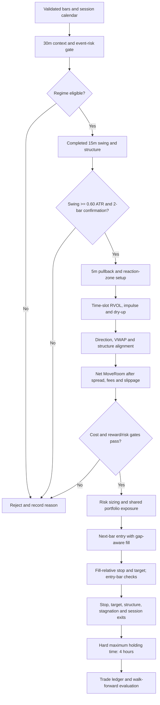

# Strategy Hardening TODO — Phase 2

**Target branch:** `feature/ph2-strategy-hardening`  
**Scope:** research, replay, and deterministic backtesting only. No live broker connectivity, exchange credentials, or automated live trading.

## Objective

Harden the current Confluence strategy and backtest simulator before expanding the instrument universe. Model realistic entry/exit execution, enforce the four-hour maximum holding period, account for trading costs honestly, and evaluate performance across distinct regimes without overfitting.

Initial research universe:
- US equities and liquid US-listed ETF proxies.
- One explicitly selected gold instrument.
- One explicitly selected oil instrument.

Keep ETF proxies and futures contracts distinct. A proxy ETF result does not validate a futures strategy. Do not expand to international markets or crypto in this phase.

## End-to-end decision and execution flow

## 1. Entry quality and multi-timeframe causality

- [x] Use completed 30-minute bars for discovery/context; never use a still-forming higher-timeframe bar. Aggregation rejects incomplete, non-final, partial, or non-contiguous source buckets.
- [x] Implement a fail-closed event-risk gate with a provider-neutral, timestamped assessment contract and a backtest provider callback. When `event_risk.required` is true, missing, stale, future-dated, unknown, or blocked assessments reject new entries and the decision card records state, timestamp, and reason. No external calendar/news provider is bundled; callers must supply one.
- [x] Build 15-minute swing/structure anchors from completed 15-minute bars, not 5-minute bars relabeled as 15-minute structure.
- [x] Require minimum swing size of at least 0.60 ATR using 15-minute ATR.
- [x] Require two-bar confirmation after the swing point; confirmation is available only after both bars close.
- [x] Use 5-minute bars for entry timing, pullback/reaction-zone qualification, and execution decisions (the runner uses its supplied signal interval; the configured production baseline is 5 minutes).
- [x] Add time-of-day/slot-normalized RVOL using the same exchange-local wall-clock slot in up to 10 prior completed sessions. Require at least 5 comparable sessions; exclude the current session and future bars. Insufficient history returns unavailable and the entry gate fails closed.
- [x] Use slot-normalized RVOL for the baseline entry floor; retain rolling RVOL as a separate diagnostic and keep impulse strength/pullback dry-up as additional gates.
- [x] Keep trend and chop playbooks distinct: TREND_DAY retains directional pullback zones and mirrored close confirmation for long/short; CHOP_DAY is restricted to deep range-edge reclaim setups. Trend-continuation core/shallow/momentum entries are blocked in chop.
- [x] Record gross performance by entry regime and long/short side in `by_regime` and `by_regime_side` summaries. Do not globally disable shorts based on aggregate results.
- [x] Record diagnostics for 30-minute context regime/time, 15-minute swing direction/size/confirmation, 5-minute slot/rolling RVOL inputs, and event-risk state/timestamp/reason.

## 2. Position lifecycle and time exits

- [x] Enforce a hard maximum holding period of **4 hours from actual fill time**, not signal or order-submission time. On aligned intervals, exit at the deadline bar open; if the deadline falls inside a bar or data gap, use the last completed pre-deadline close to avoid post-deadline data and never exceed the cap.
- [x] Add a configurable stagnation/time-stop when the trade fails to make required progress within configured bars/minutes. Keep this separate from the hard four-hour limit. Current default: 60 minutes without +0.25R maximum favourable excursion.
- [x] Define stops relative to actual fill and re-anchor ATR-extension targets to the fill while preserving their signal-time distance. Structural targets remain fixed market levels; reject next-bar gaps that invalidate direction or minimum reward/risk.
- [x] Apply reaction-zone `size_weight` values to final risk sizing; core defaults to 1.00 and shallow/deep/momentum weights scale the risk budget when supplied by the strategy card. Broader per-zone integration coverage remains.
- [x] Preserve mandatory session/pre-close flattening for the initial US equity/ETF universe. Gold and oil are explicitly restricted to US-listed ETF proxies (GLD/USO); GC/CL futures are excluded until their distinct exchange sessions, contract multipliers, margin, and fee profiles are implemented.
- [x] Record exit reason and elapsed holding time for every trade in the trade ledger; report average, median, and maximum holding duration.

## 3. Execution simulator correctness

- [x] Check the entry bar for stop/target touches after a pending entry fills; do not skip its high/low.
- [x] Model adverse opening gaps through stops with gap-aware fills at the bar open rather than always filling exactly at the stop price.
- [x] Anchor stops to the actual fill; re-anchor ATR-extension targets to the fill and reject structural-target gaps that invalidate reward/risk. Structural market levels remain fixed rather than moving with the fill.
- [x] If stop and target are both touched within one OHLC bar and tick ordering is unavailable, retain a documented conservative assumption (stop first) and expose the ambiguity through distinct exit reasons.
- [x] Route next-bar market entries through `OrderSimulator`; preserve filled/partial/rejected status and scale position risk to actual filled quantity.
- [x] Unify execution and realized cost treatment: OrderSimulator owns market-open/partial/rejected fills; the cost ledger owns spread, slippage, commission, and regulatory fees exactly once. Before accepting an entry, the runner estimates known itemized round-trip cost at the signal close using a conservative 0.68 reaction-zone size weight. After the next-bar fill, it rechecks MoveRoom using actual filled quantity, fill price, target price, and the same itemized cost functions used by realized P&L. Missing/estimated fields remain partial-net and are disclosed.
- [x] Add deterministic tests for next-bar gaps, entry-bar stop-outs/targets, gap-through-stop, both-levels-touched bars, and session flattening (session flatten also has a strategy-level contract test).

## 4. Trading costs and reporting integrity

- [x] Distinguish `gross`, `partial_net`, and `fully_net` cost coverage in per-symbol and combined summaries (no-trade summaries are labelled `no_trades`); persist trade-level cost status in CSV and run-level status in JSON.
- [x] Mark trades/summaries `fully_net` only when all required cost components are present, verified, and applied; excluded or estimated fields force `partial_net` when known costs are applied.
- [x] Correct full-net eligibility: any excluded or estimated required cost field prevents a `fully_net` label. Per-symbol reports expose `cost_status`, excluded fields, and estimated fields.
- [x] Apply sell-only SEC/FINRA regulatory fees on the actual sell leg for both long and short trades; short-entry and long-exit fees are tested separately.
- [x] Do not map commodity futures to generic US ETF cost assumptions. GC=F/CL=F remain outside the baseline; GLD and USO use separate symbol-specific spread fields. Their spread values are still unavailable, so those instruments remain `partial_net` until measured.
- [x] Keep GLD/USO ETF proxy metadata and cost-spread fields separate from futures. Their US regular-session calendar, USD/share units, 0.01 tick, and 1x share multiplier are explicit; instrument-specific spreads remain not-found until measured. Futures remain excluded pending distinct calendars, multipliers, margin, and fee profiles.
- [x] Ensure MoveRoom and realized P&L use compatible cost assumptions without double-counting: pre-entry screening uses a conservative estimate; post-fill qualification recalculates known itemized round-trip costs from actual filled quantity and prices using the same cost functions as P&L. Missing spread/fee data remains excluded and keeps results `partial_net` until measured.
- [x] If slippage is estimated or unavailable, disclose it in `estimated_cost_fields` / `cost_fields_excluded` and downgrade the result to `partial_net`; known cost components are still applied.

## 5. Shared portfolio simulation

- [x] Apply a deterministic shared portfolio ledger to combined-run trade candidates in chronological entry order (entry timestamp, symbol, exit time tie-break).
- [x] Enforce total capital, per-trade risk, per-market allocation, correlated-cluster exposure, maximum concurrent positions, and available-cash constraints; initial baseline capital defaults to USD 100,000 and rejects higher values.
- [x] Resolve simultaneous candidate trades deterministically by entry time, symbol, then exit time; shared reservations prevent multiple symbols spending the same cash.
- [x] Reserve cash using the greater of known itemized entry costs and the configured market round-trip cost buffer; this is a reservation only and is not added to realized P&L.
- [x] Exclude disabled markets before market-sleeve capital preallocation and report each excluded instrument with its blocking reason.
- [ ] Complete fully event-driven candidate generation so concurrency and cluster reservations determine quantity before each symbol lifecycle. Market-sleeve capital is now allocated to each active symbol before its lifecycle simulation; the chronological shared ledger still performs a final cross-symbol concurrency/cluster scale-or-reject pass and does not yet re-trigger deferred signals.
- [x] Report portfolio-rejected trades with symbol, timestamp, requested size/notional, and exact blocking constraint.
- [x] Keep the initial portfolio capital ceiling at the approved **USD 100,000**, unless explicitly changed by the user.

## 6. Regime and instrument scope

- [x] Default baseline scope accepts only configured US equity/ETF symbols plus GLD (gold ETF proxy) and USO (oil ETF proxy). SPX/^GSPC and futures symbols are excluded; broader profiles require explicit baseline_scope=False for software tests only.
- [x] Verify baseline instrument assumptions: US-listed shares/ETFs use USD, 1-share units, 1x multiplier, $0.01 tick, and the New York regular session. Futures are excluded pending their own sessions/multipliers/margin/cost profiles. Per-symbol spread evidence remains an explicit open item.
- [x] Label zero-trade instruments explicitly and state that zero trades are not evidence of profitability or unprofitability.
- [x] Add gross performance reporting for `BULL_TREND`, `BEAR_TREND`, `NORMAL`, `SIDEWAYS`, and `HIGH_VOL_CHOP`, including long/short cross-tabs. The reporting classifier is diagnostic only and does not change entry eligibility; high-vol chop uses current 5m ATR versus the prior 20 observations.
- [x] Detect explicit synthetic-fixture manifests and label results synthetic_software_fixture_only; do not treat them as market-performance evidence.

## 7. Acceptance tests and validation

- [x] Unit tests: higher-timeframe finality, no lookahead, 15m swing threshold, two-bar confirmation, slot RVOL (same-slot prior-session ratio, insufficient-history fail-closed, future-bar exclusion), impulse-RVOL branch, event-risk fail-closed states, direction/regime filters, and size weights are covered.
- [x] Lifecycle tests: exact four-hour maximum measured from fill, stagnation exit, session flatten, and exit-reason/holding-duration accounting are covered.
- [x] Execution tests: gap-aware entries/stops, fill-relative stop/target, entry-bar checks, both-levels-touched ambiguity, partial fills/rejections, and cost coverage.
- [x] Portfolio tests: shared cash/market allocation, cluster exposure, maximum concurrency, expiry release, disabled markets, and fail-closed missing cluster configuration. Combined-run determinism is also tested; simultaneous candidate ordering is deterministic by timestamp then symbol.
- [x] Full suite on Python 3.12 and 3.13: `python -m unittest discover -s tests -v` — 234 tests passed, 3 skipped on each version (CI run 46140493871). `python -m compileall -q app tests` and `ruff check app tests` also passed.
- [ ] Re-run bull, bear, normal, sideways, great-choppy, and combined datasets with identical assumptions; compare gross and net results separately.
- [ ] Run chronological out-of-sample and walk-forward evaluation. Do not tune against the test period.
- [x] Report trade count, win rate, gross PF, net PF (only where cost coverage permits), expectancy, drawdown, average/median/maximum holding time, exit-reason distribution, and per-symbol/per-market-phase/per-regime/per-direction breakdown.
- [x] Unit/integration tests verify the four-hour cap, completed-bar causality, higher-timeframe finality, and exclusion of future bars from slot RVOL. A full historical-dataset audit remains pending.
- [ ] Do not accept a change solely because it improves bull-market performance. Assess normal, sideways, and choppy performance while checking that bull/bear behavior has not been destroyed.

## 8. Implementation order

1. [x] Four-hour hard time limit and stagnation exit.
2. [x] Execution simulator fixes (entry-bar checks, gap handling, fill-relative risk and gap-entry rejection).
3. [x] True 30m/15m/5m causal timeframe pipeline, swing confirmation, fail-closed event-risk gate, and slot-normalized RVOL.
4. [x] Slot-normalized RVOL, higher-timeframe diagnostics, and reaction-zone sizing are implemented and covered by focused regression tests.
5. [x] Instrument-specific ETF proxy spread profiles and truthful gross/partial-net/fully-net reporting; MoveRoom cost parity remains open under section 4.
6. [x] Shared portfolio capital, concurrency, and exposure constraints are applied chronologically after symbol replay; portfolio feedback into candidate generation remains open under section 5. Core ledger and chronological candidate filtering are implemented; pre-signal sizing feedback remains open.
7. [ ] Full regression suite, chronological out-of-sample, and walk-forward report.

## Safety boundary

This phase is strictly for local research, deterministic replay, backtesting, and demo-only evaluation. Do not add live broker/exchange connections, live order routing, credential handling, or automated trading. Do not weaken existing fail-closed policy gates or risk limits to improve historical metrics.
