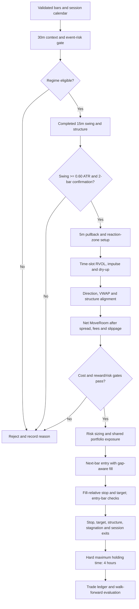

# Strategy Hardening TODO — Phase 2

**Target branch:** `feature/ph2-strategy-hardening`  
**Scope:** research, replay, and deterministic backtesting only. No live broker connectivity, exchange credentials, or automated live trading.

## Objective

Harden the current Confluence strategy and backtest simulator before expanding the instrument universe. Model realistic entry/exit execution, enforce the four-hour maximum holding period, account for trading costs honestly, and evaluate performance across distinct regimes without overfitting.

Initial research universe:
- US equities and liquid US-listed ETF proxies.
- One explicitly selected gold instrument.
- One explicitly selected oil instrument.

Keep ETF proxies and futures contracts distinct. A proxy ETF result does not validate a futures strategy. Do not expand to international markets or crypto in this phase.

## End-to-end decision and execution flow

## 1. Entry quality and multi-timeframe causality

- [x] Use completed 30-minute bars for discovery/context; never use a still-forming higher-timeframe bar. Aggregation rejects incomplete, non-final, partial, or non-contiguous source buckets.
- [ ] Implement a fail-closed event/news-risk gate. If event-risk data is unavailable or stale, record the uncertainty and reject entries where policy requires this gate.
- [x] Build 15-minute swing/structure anchors from completed 15-minute bars, not 5-minute bars relabeled as 15-minute structure.
- [x] Require minimum swing size of at least 0.60 ATR using 15-minute ATR.
- [x] Require two-bar confirmation after the swing point; confirmation is available only after both bars close.
- [x] Use 5-minute bars for entry timing, pullback/reaction-zone qualification, and execution decisions (the runner uses its supplied signal interval; the configured production baseline is 5 minutes).
- [ ] Add time-of-day/slot-normalized RVOL using comparable prior sessions. Do not compare an opening bar with a full-session average.
- [ ] Make impulse-RVOL and ordinary slot-RVOL requirements consistent. An impulse branch must not accidentally bypass the baseline volume gate unless explicitly configured.
- [ ] Keep trend and chop playbooks distinct. Do not force trend-following entries into sideways/choppy conditions.
- [ ] Evaluate long/short performance by regime. Do not globally disable shorts based on aggregate results.
- [x] Record diagnostics for 30-minute context regime/time, 15-minute swing direction/size/confirmation, and the existing 5-minute feature/RVOL inputs. Event-risk diagnostics remain pending with the event gate.

## 2. Position lifecycle and time exits

- [x] Enforce a hard maximum holding period of **4 hours from actual fill time**, not signal or order-submission time. On aligned intervals, exit at the deadline bar open; if the deadline falls inside a bar or data gap, use the last completed pre-deadline close to avoid post-deadline data and never exceed the cap.
- [x] Add a configurable stagnation/time-stop when the trade fails to make required progress within configured bars/minutes. Keep this separate from the hard four-hour limit. Current default: 60 minutes without +0.25R maximum favourable excursion.
- [x] Define stops relative to actual fill and re-anchor ATR-extension targets to the fill while preserving their signal-time distance. Structural targets remain fixed market levels; reject next-bar gaps that invalidate direction or minimum reward/risk.
- [x] Apply reaction-zone `size_weight` values to final risk sizing; core defaults to 1.00 and shallow/deep/momentum weights scale the risk budget when supplied by the strategy card. Broader per-zone integration coverage remains.
- [ ] Preserve mandatory session/pre-close flattening where applicable. Do not apply regular-session cutoffs to instruments with different sessions.
- [x] Record exit reason and elapsed holding time for every trade in the trade ledger; report average, median, and maximum holding duration.

## 3. Execution simulator correctness

- [x] Check the entry bar for stop/target touches after a pending entry fills; do not skip its high/low.
- [x] Model adverse opening gaps through stops with gap-aware fills at the bar open rather than always filling exactly at the stop price.
- [ ] Anchor stop/target calculations to actual fill price, not only signal-bar close.
- [x] If stop and target are both touched within one OHLC bar and tick ordering is unavailable, retain a documented conservative assumption (stop first) and expose the ambiguity through distinct exit reasons.
- [ ] Model spread, slippage, fees, and partial/rejected fills consistently between signal qualification, simulated execution, and realized P&L.
- [x] Add deterministic tests for next-bar gaps, entry-bar stop-outs/targets, gap-through-stop, both-levels-touched bars, and session flattening (session flatten also has a strategy-level contract test).

## 4. Trading costs and reporting integrity

- [ ] Distinguish `gross`, `partial_net`, and `fully_net` results in every report and persisted run.
- [ ] Mark a run `fully_net` only when every required cost component for every traded instrument is present and applied (commission, applicable exchange/regulatory fees, spread, and slippage).
- [ ] Correct `net_available` so excluded cost fields cannot still produce a fully-net label.
- [ ] Do not map commodity futures to generic US ETF cost assumptions. Use instrument/venue-specific cost profiles.
- [ ] Keep ETF proxy assumptions separate from futures assumptions, including session calendars, tick sizes, contract multipliers, and fees.
- [ ] Ensure MoveRoom thresholds and backtest P&L use compatible cost assumptions; avoid double-counting or omitting costs.
- [ ] If slippage is estimated or unavailable, disclose it and downgrade the result to partial-net rather than silently treating it as zero.

## 5. Shared portfolio simulation

- [ ] Replace independent per-symbol cash/equity simulations with a shared portfolio ledger for combined runs.
- [ ] Enforce total capital, per-trade risk, per-market allocation, correlated-cluster exposure, maximum concurrent positions, and available-cash constraints.
- [ ] Resolve simultaneous signals deterministically and prevent multiple symbols from spending the same cash.
- [ ] Apply position sizing only after setup weights and all portfolio constraints.
- [ ] Report rejected/deferred signals and the exact portfolio constraint that blocked them.
- [ ] Keep the initial portfolio capital ceiling at the approved **USD 100,000**, unless explicitly changed by the user.

## 6. Regime and instrument scope

- [ ] Validate the initial universe explicitly: selected US equity/ETF instruments, one gold instrument, and one oil instrument.
- [ ] Verify each instrument's session calendar, timezone, tick/price units, multiplier, and cost profile against its actual instrument type.
- [ ] Do not interpret zero trades in an instrument as evidence of profitability or unprofitability.
- [ ] Add regime-specific reporting for bull/trend, bear/trend, normal, sideways, and high-volatility/choppy periods.
- [ ] Treat synthetic fixtures as software tests only, never as evidence of real-market profitability.

## 7. Acceptance tests and validation

- [ ] Unit tests: higher-timeframe finality, no lookahead, 15m swing threshold, two-bar confirmation, slot RVOL, impulse-RVOL branch, event/news fail-closed behavior, direction/regime filters, and size weights.
- [ ] Lifecycle tests: exact four-hour maximum measured from fill, stagnation exit, session flatten, and exit-reason accounting.
- [ ] Execution tests: gap-aware entries/stops, fill-relative stop/target, entry-bar checks, both-levels-touched ambiguity, partial fills, and costs.
- [ ] Portfolio tests: shared cash, simultaneous signals, maximum concurrency, allocation caps, cluster exposure, and deterministic priority.
- [ ] Run the full existing unit test suite and record the exact command and result.
- [ ] Re-run bull, bear, normal, sideways, great-choppy, and combined datasets with identical assumptions; compare gross and net results separately.
- [ ] Run chronological out-of-sample and walk-forward evaluation. Do not tune against the test period.
- [ ] Report trade count, win rate, gross PF, net PF (only where cost coverage permits), expectancy, drawdown, average/median holding time, stop/target/time-exit distribution, and per-symbol/per-regime/per-direction breakdown.
- [ ] Confirm no trade exceeds four hours and no feature reads data after its decision timestamp.
- [ ] Do not accept a change solely because it improves bull-market performance. Assess normal, sideways, and choppy performance while checking that bull/bear behavior has not been destroyed.

## 8. Implementation order

1. [x] Four-hour hard time limit and stagnation exit.
2. [x] Execution simulator fixes (entry-bar checks, gap handling, fill-relative risk and gap-entry rejection).
3. [x] True 30m/15m/5m causal timeframe pipeline and swing confirmation. Event/news gating and slot-normalized RVOL remain open under item 1.
4. [ ] Slot-normalized RVOL, direction/regime diagnostics, and reaction-zone sizing.
5. [ ] Instrument-specific costs and truthful gross/partial-net/fully-net reporting.
6. [ ] Shared portfolio capital, concurrency, and exposure constraints.
7. [ ] Full regression suite, chronological out-of-sample, and walk-forward report.

## Safety boundary

This phase is strictly for local research, deterministic replay, backtesting, and demo-only evaluation. Do not add live broker/exchange connections, live order routing, credential handling, or automated trading. Do not weaken existing fail-closed policy gates or risk limits to improve historical metrics.
